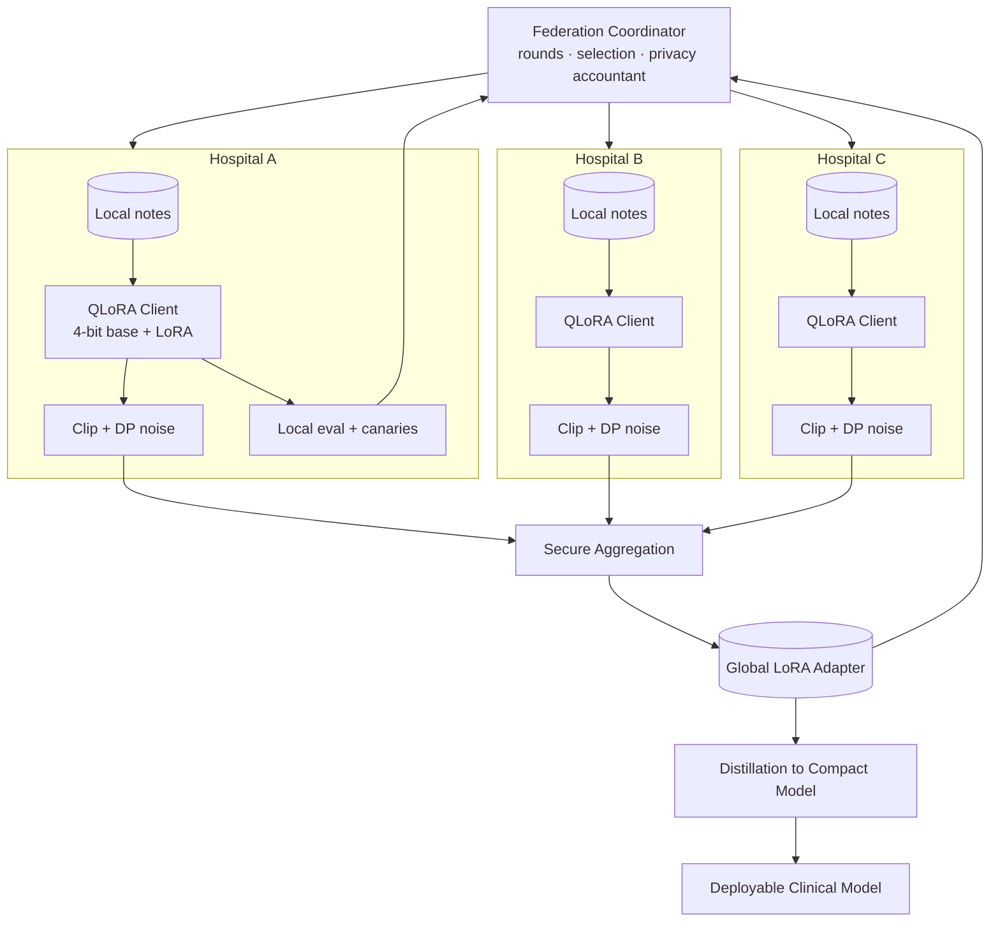

# FedLoRA Health: System Architecture

> Privacy-preserving federated fine-tuning in which hospitals collaboratively train LoRA adapters on local clinical notes without sharing data, using differential privacy, quantised clients and distillation into one global model.
>
> **Concepts:** `Fine Tuning`, `LoRA`, `Quantization`, `Overfitting`, `Embeddings`, `Knowledge Distillation`, `LLMs`

## 1. High-Level View

A coordinator runs federated rounds. Each hospital client loads a quantised base model, trains LoRA locally with clipping and noise, and sends masked updates via secure aggregation. The server updates the global adapter. Evaluation and memorisation checks run locally, and only metrics are reported. The final global adapter is distilled into a deployable model.

## 2. Components

| Component | Responsibility |
|---|---|
| Coordinator | Flower server: strategy (FedAvg/FedProx), client sampling, round configs. |
| Privacy accountant | RDP accounting of ε per site over rounds. |
| Client | QLoRA training on local data; DP clipping/noise; local eval. |
| Secure aggregation | Pairwise masking so server only sees sums. |
| Personalisation | Per-site adapter layered on global adapter. |
| Monitors | Local held-out loss, canary exposure; reported as aggregates. |
| Distiller | Teacher = base + global adapter; student = compact model. |

## 3. Request / Data Flow

1. Coordinator selects K sites for round r, sends global adapter.
2. Each site trains E local epochs with QLoRA; clips and noises update.
3. Masked updates → secure aggregation → new global adapter.
4. Sites evaluate locally (global + personal); report metrics only.
5. Accountant updates ε; stop when budget or convergence reached.
6. Distil final model; run memorisation tests; release.

## 4. Data Stores

| Store | Holds | Why |
|---|---|---|
| Coordinator DB | Round metadata, metrics, ε ledger, signed update hashes | Audit. |
| Site-local storage | Data, checkpoints | Never leaves site. |

## 5. Deployment Topology

- Client packaged as a container for hospital on-prem GPU (24GB).
- Coordinator in a neutral cloud/trusted third party.

## 6. Scaling Strategy

- Asynchronous rounds for stragglers; client dropout tolerance in SecAgg.

## 7. Security & Privacy

- mTLS between clients and coordinator; signed updates.
- DP + SecAgg + minimum cohort size.
- Outbound-only connections from hospitals.

## 8. Observability

- Round progress, participation, per-site aggregated metrics, ε budget dashboard.

## 9. Failure Modes

| Failure | Detection | Response |
|---|---|---|
| Client drops mid-round | Timeout | SecAgg dropout recovery; round continues with remaining clients. |
| Privacy budget exhausted | Accountant | Site excluded from further rounds. |
